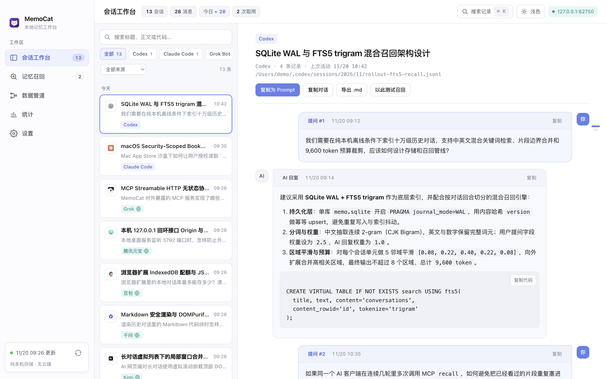
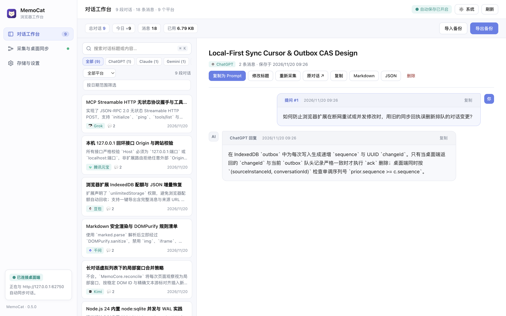

# MemoCat

纯本机离线的 AI 对话归档、结构化阅读工作台与跨 AI MCP 记忆召回工具。附带 Electron macOS 桌面应用、同功能本机网页工作台与 Chrome / Edge Manifest V3 浏览器扩展。

- **项目主页**：https://memocat.qiwihui.com/ （[English](https://memocat.qiwihui.com/en/)）
- **源码仓库**：https://github.com/qiwihui/MemoCat
- **隐私政策**：https://memocat.qiwihui.com/privacy.html
- **技术支持**：https://memocat.qiwihui.com/support.html
- **开源协议**：[MIT License](LICENSE)

---

## 界面预览

| 桌面工作台（会话阅读、检索与召回） | 浏览器扩展工作台（9 大网页 AI 平台采集） |
| --- | --- |
|  |  |

---

## 核心特性

### 1. 双端输入采集

- **4 类本机终端 / 桌面 AI 日志（只读扫描）**
  - `Codex`（默认路径 `~/.codex`）：解析 `session_meta`、`response_item` 与 `event_msg` 回退记录，排除 subagent 日志并提取输入图片。
  - `Claude Code`（默认路径 `~/.claude/projects`）：读取可见 user/assistant 文本，跳过 sidechain 记录，提取内嵌 base64 图片与长粘贴文档附件。
  - `Grok Bot`（默认路径 `~/Library/Application Support/Grok Bot`）：扫描持久化 `.blob` 副本并解析会话标题与记录。
  - `Antigravity`（默认路径 `~/.gemini/antigravity`）：读取会话转录日志，清理内部标签并跳过 subagent 记录。
  - 支持流式逐行大日志解析、读前/读后文件身份与修改时间校验、多副本快照合并去重，以及本地哈希图片缓存（PNG/JPEG/GIF/WebP，单张上限 32 MB）。
  - 定时自动同步支持 1–1440 分钟间隔配置（默认 5 分钟），应用退出不后台唤醒，关闭来源不删除已存档记录。

- **9 大网页 AI 平台扩展（Chrome / Edge Manifest V3）**
  - 支持 `ChatGPT`、`Claude`、`Gemini`、`DeepSeek`、`腾讯元宝`、`豆包`、`Kimi`、`千问`、`Grok`（含 `x.com/i/grok`）。
  - 提供页面悬浮保存胶囊、网页右侧抽屉栏、工具栏弹出面板与独立全屏工作台。
  - 默认手动保存，支持全局与分平台自动保存；采用局部窗口增量合并（`MemoCore.reconcile`），虚拟列表卸载早期 DOM 节点时不丢失历史消息。
  - 数据独立存储于浏览器 IndexedDB（`unlimitedStorage`），支持单会话 Markdown/JSON 导出、全库增量 JSON 备份恢复，以及通过 `http://127.0.0.1:3792` 一键配对并增量同步至桌面库（详见 [extension/README.md](extension/README.md)）。

### 2. 结构化会话工作台

- 顶部与左栏集成会话数、消息数、今日增量与取用次数概览。
- 支持 `⌘K` 全文/标题/代码关键词检索、来源快速筛选胶囊、`↑` / `↓` 列表切换。
- 正文按时间顺序采用左右聊天气泡布局，通过 `marked` + `DOMPurify` 安全渲染 Markdown 与代码块（附一键复制代码、长粘贴文档下载、图片点击放大预览、右侧提问目录大纲）。
- 支持一键「复制为 Prompt」（结构化 XML 上下文）、「复制对话」与导出 `.md`。
- 支持系统 / 浅色 / 深色三态主题与窄屏（`< 600px`，1/4 屏宽）自适应底部标签栏。

### 3. 混合检索与跨 AI HTTP MCP 互通

- **持久化与索引**：单库 `memo.sqlite` 开启 SQLite WAL 与 FTS5 `trigram` 索引，支持内容哈希幂等 upsert。
- **混合召回引擎**：CJK 连续 2-gram（Bigram）与英文/数字词元混合切分；用户提问权重 `2.5`、AI 回复权重 `1.0`；主查询（权重 `1.0`）配合最多 8 条补充关键词（权重 `0.72`）；归一化 TF/IDF 打分、5 邻域平滑与区域合并，单次最多输出 `8` 个区域、总预算约 `9,600 token`。
- **上下文去重与交付审计**：通过 `process_id` 绑定调用方上下文，记录 `prepared` / `committed` / `abandoned` 三态交付并在「MCP 取用审计流」保留快照；已成功返回的完整单元不重复返回。
- **统计洞察**：提供存储磁盘占用、7/30 天按日入库堆叠柱状图与各平台占比分布。

---

## 环境要求与安装运行

需要 **Node.js 24+**（使用内置 `node:sqlite` 模块）；桌面端打包与运行面向 **macOS 12.0+**。

```bash
git clone https://github.com/qiwihui/MemoCat.git
cd MemoCat
```

### 方式一：Electron 桌面端

```bash
npm install
npm run desktop
```

- 桌面版默认使用端口 **3792**，支持原生菜单栏、`⌘1..5` 视图切换、托盘后台驻留以及 macOS Security-Scoped Bookmarks 只读目录授权。
- macOS 下也可直接双击根目录的 [Start MemoCat.command](Start%20MemoCat.command) 启动（若已安装 Electron 则启动桌面版，否则启动本机网页版）。

### 方式二：本机网页工作台（无额外后端依赖）

服务端仅使用 Node.js 24 内置模块，可直接启动：

```bash
npm start
# 打开 http://127.0.0.1:3792
```

可通过环境变量自定义数据目录与端口：

```bash
MEMO_DATA_DIR=/absolute/path/to/data PORT=3792 npm start
```

### 方式三：Chrome / Edge 浏览器扩展

```bash
npm run build:extension
```

1. 打开浏览器扩展管理页（`chrome://extensions` 或 `edge://extensions`），开启「开发者模式」。
2. 点击「加载已解压的扩展程序」，选择构建生成的 `dist/memocat-extension` 目录（或直接加载 `extension` 目录）。
3. 在扩展「采集与桌面同步」中点击「一键连接 MemoCat 并同步」，即可自动配对本机运行中的 `127.0.0.1:3792` 服务。

---

## 首次使用

1. 运行桌面版或 `npm start` 打开 `http://127.0.0.1:3792`。
2. 在左侧导航进入 **数据管道**，展开 `Codex`、`Claude Code`、`Grok Bot` 或 `Antigravity`，选择或核对来源目录后开启开关并点击「立即同步」。
3. 在 **会话工作台** 浏览结构化对话，或按下 `⌘K` 搜索历史内容。
4. 在 **记忆召回** 沙盒中输入查询问题并补充同义关键词，验证命中的上下文片段与 Token 预算占用。
5. 如需在其他 AI 工具中调用记忆，在 **数据管道 → 输出 · 本机 MCP 服务端点** 中开启对应客户端并配置允许读取的来源白名单。

---

## MCP 配置示例

MemoCat 仅监听本机回环地址 `127.0.0.1:3792`，提供无状态 Streamable HTTP POST（JSON-RPC 2.0），内置 `recall` 和 `list_conversations`（按主机时区查询最多 31 天内的会话清单）两个工具。

- **Codex**（`~/.codex/config.toml`）：

```toml
[mcp_servers.memocat]
url = "http://127.0.0.1:3792/mcp/codex"
```

- **Claude Code**（终端 CLI）：

```bash
claude mcp add --transport http --scope user memocat http://127.0.0.1:3792/mcp/claude-code
```

- **其他本机 HTTP MCP 客户端**（需先在数据管道中启用 `其他本机 AI` 端点）：

```json
{
  "mcpServers": {
    "memocat": {
      "type": "http",
      "url": "http://127.0.0.1:3792/mcp/other-local"
    }
  }
}
```

> 路径后缀（`/mcp/codex`、`/mcp/claude-code`、`/mcp/other-local`）用于区分本机调用方、隔离上下文并应用各自来源白名单，不作为公网认证凭据；请勿通过反向代理将端口暴露到公网。

---

## 存储与安全边界

- **本地数据位置**：
  - 本机网页模式默认位于 `~/.memocat/<用户ID>/memo.sqlite`（可通过 `MEMO_DATA_DIR` 覆盖）。
  - Electron 桌面版位于系统 `userData` 目录下的 `library/memo.sqlite`，两者数据目录相互独立。
  - 备份前请先正常退出应用，再复制整个数据目录。
- **隐私与访问控制**：
  - 无用户账号、无云端服务器、无第三方统计或遥测 SDK（见 [docs/privacy-policy.md](docs/privacy-policy.md)）。
  - HTTP 服务严格校验 `Host`、`Origin` 与 `Sec-Fetch-Site`；扩展同步请求校验 32 位扩展 ID 与本机生成的 256 位随机 Bearer 密钥。
- **已知边界（v0.5.0）**：
  - 本地 `memo.sqlite` 与扩展导出的 JSON 备份以明文存储对话文本，当前未在应用层额外加密，请配合操作系统磁盘加密与文件权限管理。
  - 浏览器扩展仅采集当前网页 DOM 中已加载的文字内容，不调用聊天平台私有接口拉取未展开的历史，也不自动下载远程图片或音视频。
  - 暂不自动删除源文件已移除的旧记录；对已损坏的日志行会保留上次成功导入的版本。

---

## 打包、部署与测试

```bash
# 运行全部单元与集成测试
npm test

# 运行浏览器扩展端到端测试（默认调用本机 Microsoft Edge，可用 MEMO_BROWSER_BINARY 指定）
npm run test:extension:browser

# 构建扩展 ZIP（dist/memocat-extension.zip）与 Chrome Web Store 素材
npm run build:extension
npm run build:cws

# 构建 macOS DMG 磁盘映像 / Mac App Store 安装包结构
npm run build:dmg
npm run build:mas

# 校验并发布 docs/site/ 至 GitHub Pages (gh-pages 分支)
node scripts/deploy-pages.mjs --dry-run
npm run deploy:pages
```

更多测试与校验细节见 [VERIFICATION.md](VERIFICATION.md)。

---

## 目录结构

```text
src/            后端核心模块（adapters、store、recall、service、server、interop、desktop 等）
public/         桌面端与本机网页前端界面与静态资源
extension/      Chrome / Edge Manifest V3 浏览器扩展源码
build/          macOS App Sandbox Entitlements 与 PrivacyInfo.xcprivacy
scripts/        扩展构建、商店素材生成、DMG/MAS 打包与 GitHub Pages 部署脚本
docs/           隐私政策与产品站点源码（docs/site/）
test/           单元测试与端到端集成测试
```

---

## 开源许可

本项目基于 [MIT License](LICENSE) 开源；界面中使用的部分 MingCute SVG 图标遵循 Apache-2.0 许可证，第三方产品图标归属与说明见 [public/assets/SOURCES.md](public/assets/SOURCES.md)。
